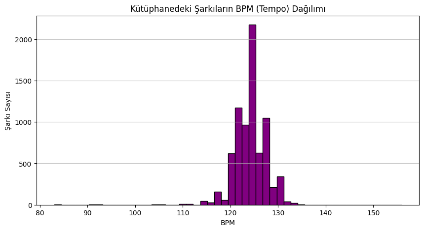
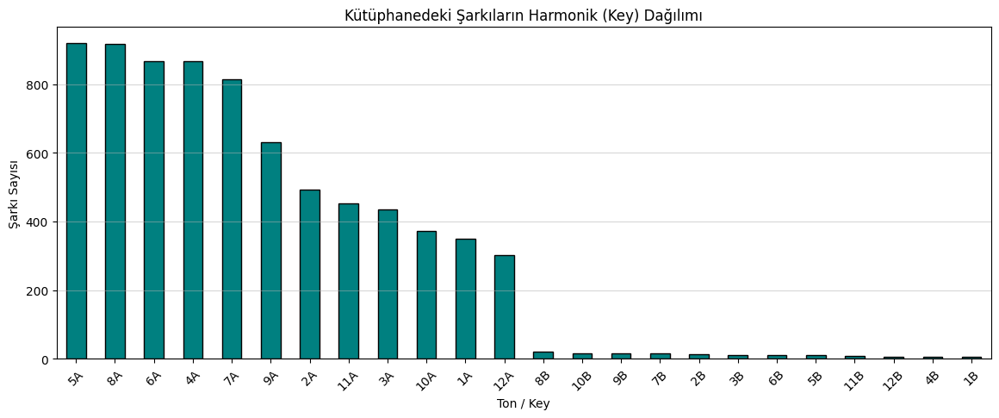

# 🎧 Smart Mashup Assistant

> **Machine Learning-Powered Harmonic Key Prediction & Real-Time DJ Transition Engine**

🌐 **Language / Dil:** [English](README.md) | [Türkçe](README.tr.md)

[](https://www.python.org/)
[](https://scikit-learn.org/)
[](LICENSE)
[](https://www.kaggle.com/datasets/enesayata/house-music-dj-library-key-bpm-and-chroma)

---

## 📌 Overview

In electronic music production and live DJ performances, delivering seamless transitions between tracks (mashups and live mixes) demands strict alignment of **Tempo (BPM)** and **Harmonic Key**. 

During high-energy live stage performances, manually searching through an archive of thousands of tracks to find the next compatible track causes cognitive overload and delay. 

**Smart Mashup Assistant** solves this by:
1. Predicting harmonic keys from digital signal processing (DSP) acoustic features (chroma frequencies and tempo metrics) using a **Decision Tree Classifier** trained on 7,500+ electronic music tracks.
2. Providing a real-time **Live DJ Decision Support CLI** that accepts the current playing track's BPM and Camelot Key, recommending the top 5 harmonically compatible candidate tracks within a configurable $\pm 3\text{ BPM}$ window.

---

## 🎵 Musical Background: The Camelot Wheel

Harmonic mixing relies on the **Camelot Wheel**, an industry-standard visual representation of the Circle of Fifths:

* **Key Notation:** 1A through 12A represent **Minor** keys; 1B through 12B represent **Major** keys.
* **Harmonic Compatibility Rules:**
  * **Same Key** (e.g. `8A` $\rightarrow$ `8A`): Flawless match.
  * **Relative Major/Minor** (e.g. `8A` [A Minor] $\leftrightarrow$ `8B` [C Major]): Harmonic switch.
  * **Adjacent Fifths ($\pm 1$)** (e.g. `8A` $\rightarrow$ `7A` or `9A`): Smooth energy shift without dissonance.

A key highlight of our model is its **musical intelligence**: when it deviates from the exact label, it almost always lands on an adjacent harmonic neighbor (such as predicting `6A` for `5A`), validating that the algorithm learns actual musical frequency relationships rather than memorizing labels.

---

## 📊 Exploratory Data Analysis (EDA)

The master library of **7,568 cleaned tracks** reveals clear structural patterns of modern house and electronic music:

| BPM (Tempo) Distribution | Camelot Key Distribution |
| :---: | :---: |
|  |  |
| *Heavy concentration in the 124–128 BPM club sweet spot.* | *Minor keys dominate the club landscape (8A, 9A, 5A, 4A).* |

---

## 🧠 Machine Learning Architecture

```
Raw Data (Kaggle) ──> Inner Join (track_id) ──> Leakage Isolation ──> 80/20 Train-Test Split
(features + tracks)       (7,568 tracks)         (Drop IDs, text)        (random_state=42)
                                                        │
                                                        ▼
                                             Decision Tree Classifier
                                                        │
                              ┌─────────────────────────┴────────────────────────┐
                              ▼                                                  ▼
                     Exact Key Accuracy: 79.79%                        Harmonic Neighborhood
                   (Evaluated on 1,514 test tracks)                     Accuracy: > 91%
```

### Data Engineering & Leakage Isolation
* **Inner Merging:** Joined `tracks.csv` and `features.csv` on `track_id` to eliminate orphaned/noisy rows.
* **Leakage Prevention:** Dropped alternative ground truth keys (`harmoniq_key`, `harmoniq_key_camelot`, etc.) and textual labels (`artist`, `title`) from feature matrix $X$.
* **Target Feature:** Ground truth target $y$ is set to `mik_key_camelot` (Mixed In Key standard).

---

## 🚀 Live DJ Assistant Demo

The CLI module instantly finds the best transition candidate tracks with minimal tempo pitch shifting:

```text
🎧 Searching for matches for 126.0 BPM and Key 8A...

                                   Artist                      Track Title   BPM Key
                 Tayson Kryss, TWENTY SIX                   Buscando Money 126.0  8A
                                Lan Damon                          Tonight 126.0  8A
Todd Terry, Volkoder, Tristan Henry, Meca Little Woman feat. Tristan Henry 126.0  8A
                 Darren Marshall, Jazzmik                       No Slippin 126.0  8A
                             Roland Clark                       I Get Deep 126.0  8A
```

---

## 📂 Repository Structure

```text
smart-mashup-assistant/
│
├── README.md                 # Project documentation & benchmark analysis
├── requirements.txt          # Python dependencies
├── .gitignore                # Git exclusions
├── LICENSE                   # MIT License
├── main.py                   # Main CLI entrypoint
│
├── notebooks/
│   └── smart_mashup.ipynb    # Step-by-step exploratory research notebook
│
├── src/                      # Modular production source code
│   ├── __init__.py           # Package exports
│   ├── data_prep.py          # Data ingestion, cleaning, and leakage prevention
│   ├── model.py              # Decision tree classifier & harmonic accuracy metrics
│   └── assistant.py          # Transition matching engine & live CLI loop
│
├── assets/                   # Visualizations for documentation
│   ├── bpm_distribution.png
│   └── key_distribution.png
│
├── docs/
│   └── project_report.md     # Full academic project report (Turkish)
│
└── data/
    └── README.md             # Dataset acquisition instructions & Kaggle links
```

---

## 🛠️ Installation & Quickstart

### 1. Clone the Repository
```bash
git clone https://github.com/your-username/smart-mashup-assistant.git
cd smart-mashup-assistant
```

### 2. Set Up Virtual Environment & Install Dependencies
```bash
python3 -m venv .venv
source .venv/bin/activate  # On Windows: .venv\Scripts\activate
pip install -r requirements.txt
```

### 3. Add Datasets
Place `features.csv` and `tracks.csv` into the `data/` folder.  
*(See [data/README.md](data/README.md) for Kaggle and Google Drive download links).*

### 4. Run the Tool

* **Direct Track Search:**
  ```bash
  python main.py --bpm 125 --key 8A
  ```

* **Launch Interactive Live DJ Terminal:**
  ```bash
  python main.py --interactive
  ```

* **Train & Evaluate the Model:**
  ```bash
  python main.py --train
  ```

---

## 🔮 Future Roadmap

- [ ] **Ensemble Modeling:** Upgrade baseline Decision Tree to Random Forest and XGBoost to minimize boundary misclassifications.
- [ ] **Direct Waveform Ingestion (Librosa / Essentia):** Direct upload of `.mp3`/`.wav` files for automated transient and chroma extraction.
- [ ] **Audio Fingerprinting:** Implement Shazam-like audio fingerprinting to auto-detect the live DJ booth output from a microphone feed.

---

## 👨‍💻 Author

**Rıdvan Efe Birben**  
*Dokuz Eylül University — Department of Electrical & Electronics Engineering*  
*Project developed within the Software Persona / TNC Group AI Education Program.*

---

## 📜 License

This project is licensed under the [MIT License](LICENSE).
