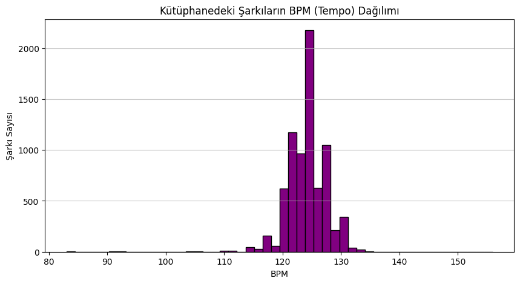
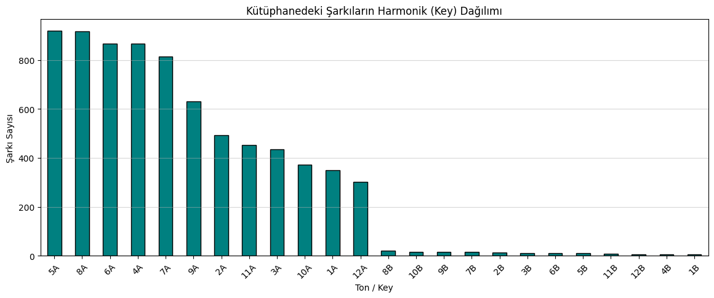

# 🎧 Smart Mashup Assistant

> **Makine Öğrenmesi ile Harmonik Ton Tahmini ve Gerçek Zamanlı Canlı DJ Geçiş Asistanı**

🌐 **Language / Dil:** [English](README.md) | [Türkçe](README.tr.md)

[](https://www.python.org/)
[](https://scikit-learn.org/)
[](LICENSE)
[](https://www.kaggle.com/datasets/enesayata/house-music-dj-library-key-bpm-and-chroma)

---

## 📌 Genel Bakış

Elektronik müzik prodüksiyonunda ve canlı DJ performanslarında, parçalar arası kusursuz geçişler (mashup ve miksaj) yapabilmek hem **Ritim (BPM)** hem de **Harmonik Ton (Key)** uyumunun eksiksiz sağlanmasını gerektirir.

Canlı sahne performansı sırasında binlerce parçalık devasa bir arşiv içinde o an çalınan şarkıya tempo ve ton olarak en uygun sıradaki parçayı bulmak ciddi bir odak ve zaman kaybı yaratır.

**Smart Mashup Assistant** bu problemi iki temel adımla çözer:
1. Dijital sinyal işleme (DSP) ses frekans analizlerinden (Chroma ve tempo öznitelikleri) yararlanarak, 7.500'ü aşkın elektronik müzik parçasıyla eğitilmiş bir **Karar Ağacı (Decision Tree Classifier)** modeliyle şarkıların tonunu tahmin eder.
2. Sahnedeki DJ'e karar desteği sunan, o anki parçanın BPM ve Camelot Ton bilgisini alarak $\pm 3\text{ BPM}$ tolerans aralığında en uyumlu 5 parçayı anında öneren **Canlı İnteraktif DJ Asistanı** terminal uygulaması sağlar.

---

## 🎵 Müzikal Teori: Camelot Wheel (Harmonik Çember)

Harmonik miksaj, Beşliler Çemberi'nin DJ endüstrisindeki standardı olan **Camelot Wheel** sistemi üzerine kuruludur:

* **Ton Gösterimi:** 1A - 12A arası **Minör** tonları; 1B - 12B arası **Majör** tonları temsil eder.
* **Harmonik Geçiş Kuralları:**
  * **Aynı Ton** (Örn: `8A` $\rightarrow$ `8A`): Kusursuz harmonik uyum.
  * **Bağıl Majör/Minör** (Örn: `8A` [La Minör] $\leftrightarrow$ `8B` [Do Majör]): Mod değişimiyle melodik zenginlik.
  * **Komşu Beşliler ($\pm 1$)** (Örn: `8A` $\rightarrow$ `7A` veya `9A`): Uyumsuzluk yaratmadan yumuşak enerji değişimi.

Modelimizin en dikkat çeken yönü **müzikal zekâsıdır**: Model tam etiket tutturamadığı durumlarda dahi rastgele sapmak yerine Camelot çemberindeki komşu tonları (örneğin `5A` yerine `6A`) tahmin etmektedir. Bu durum algoritmanın frekanslar arasındaki armonik ilişkiyi ezberlemeden, matematiksel olarak kavradığını gösterir.

---

## 📊 Keşifsel Veri Analizi (EDA)

Temizlenmiş **7.568 parçalık** master müzik kütüphanesinin dağılımları elektronik müziğin karakteristik yapısını ortaya koymaktadır:

| BPM (Tempo) Dağılımı | Camelot Ton Dağılımı |
| :---: | :---: |
|  |  |
| *Kulüp parçalarının 124–128 BPM bandında yoğunlaştığı görülmektedir.* | *Elektronik müzikte Minör tonların (8A, 9A, 5A, 4A) baskınlığı dikkat çekmektedir.* |

---

## 🧠 Makine Öğrenmesi Mimarisi

```
Ham Veri (Kaggle) ──> İç Birleştirme (track_id) ──> Sızıntı İzolasyonu ──> %80/%20 Eğitim-Test
(features + tracks)       (7.568 Şarkı)            (Metin ve ID temizliği)    (random_state=42)
                                                             │
                                                             ▼
                                                Decision Tree Classifier
                                                             │
                              ┌──────────────────────────────┴─────────────────────────────┐
                              ▼                                                           ▼
                     Tam Doğruluk: %79.79                                     Harmonik Komşu Doğruluğu:
                (1.514 test şarkısında sınandı)                                        > %91
```

### Veri Mühendisliği ve Sızıntı (Data Leakage) İzolasyonu
* **Inner Join:** `tracks.csv` ve `features.csv` tabloları `track_id` üzerinden eşleştirilmiş; karşılığı olmayan eksik kayıtlar elenmiştir.
* **Sızıntı Önleme:** Hedef değişkenle aynı sonucu veren alternatif algoritma çıktıları (`harmoniq_key`, `harmoniq_key_camelot` vb.) ile modelin işleyemeyeceği metinler (`artist`, `title`) özellik matrisinden ($X$) izole edilmiştir.
* **Hedef Değişken:** Sektör standardı kabul edilen `mik_key_camelot` (Mixed In Key) sütunu referans alınmıştır.

---

## 🚀 Canlı DJ Asistanı Terminal Çıktısı

CLI modülü, en düşük tempo sapmasıyla sahneye en uygun geçiş adaylarını saniyeler içinde listeler:

```text
🎧 Aranıyor... 126.0 BPM ve 8A tonu için en uygun parçalar filtreleniyor...

                                   Artist                      Track Title   BPM Key
                 Tayson Kryss, TWENTY SIX                   Buscando Money 126.0  8A
                                Lan Damon                          Tonight 126.0  8A
Todd Terry, Volkoder, Tristan Henry, Meca Little Woman feat. Tristan Henry 126.0  8A
                 Darren Marshall, Jazzmik                       No Slippin 126.0  8A
                             Roland Clark                       I Get Deep 126.0  8A
```

---

## 📂 Repo Dosya Yapısı

```text
smart-mashup-assistant/
│
├── README.md                 # İngilizce ana proje dokümantasyonu
├── README.tr.md              # Türkçe detaylı proje dokümantasyonu
├── requirements.txt          # Gerekli Python kütüphaneleri
├── .gitignore                # Git dışlama kuralları
├── LICENSE                   # MIT Açık Kaynak Lisansı
├── main.py                   # Çalıştırılabilir ana CLI arayüzü
│
├── notebooks/
│   └── smart_mashup.ipynb    # Adım adım analiz ve araştırma not defteri
│
├── src/                      # Modüler kaynak kodlar
│   ├── __init__.py           # Paket dışa aktarımları
│   ├── data_prep.py          # Veri temizleme, birleştirme ve sızıntı önleme
│   ├── model.py              # Karar ağacı eğitimi ve harmonik başarı metrikleri
│   └── assistant.py          # Canlı şarkı filtreleme ve öneri motoru
│
├── assets/                   # README görselleştirmeleri
│   ├── bpm_distribution.png
│   └── key_distribution.png
│
├── docs/
│   └── project_report.md     # Akademik proje bitirme raporu
│
└── data/
    └── README.md             # Veri setini edinme ve Kaggle rehberi
```

---

## 🛠️ Kurulum ve Hızlı Başlangıç

### 1. Repoyu Klonlayın
```bash
git clone https://github.com/kullanici-adiniz/smart-mashup-assistant.git
cd smart-mashup-assistant
```

### 2. Sanal Ortam Oluşturun ve Kütüphaneleri Yükleyin
```bash
python3 -m venv .venv
source .venv/bin/activate  # Windows üzerinde: .venv\Scripts\activate
pip install -r requirements.txt
```

### 3. Veri Setlerini Ekleyin
`features.csv` ve `tracks.csv` dosyalarını `data/` klasörünün içine yerleştirin.  
*(Detaylar için [data/README.md](data/README.md) dosyasına bakabilirsiniz).*

### 4. Uygulamayı Çalıştırın

* **Doğrudan Şarkı Arama:**
  ```bash
  python main.py --bpm 125 --key 8A
  ```

* **Canlı DJ İnteraktif Terminalini Başlatma:**
  ```bash
  python main.py --interactive
  ```

* **Modeli Baştan Eğitme ve Skorları İnceleme:**
  ```bash
  python main.py --train
  ```

---

## 🔮 Gelecek Vizyonu ve Geliştirme Planı

- [ ] **Topluluk Modelleri (Ensemble):** Temel Karar Ağacı modelinin Random Forest ve XGBoost mimarilerine taşınarak sınır hatalarının azaltılması.
- [ ] **Doğrudan Ses Dalgası Analizi (Librosa / Essentia):** Sisteme doğrudan `.mp3` veya `.wav` ses dosyası yüklendiğinde transient ve chroma özniteliklerinin otomatik çıkarılması.
- [ ] **Audio Fingerprinting:** Shazam benzeri ses tanıma altyapısıyla canlı performanstaki şarkıyı mikrofondan yakalayıp kütüphaneye otomatik kaydeden otonom bir veri döngüsü kurulması.

---

## 👨‍💻 Hazırlayan

**Rıdvan Efe Birben**  
*Dokuz Eylül Üniversitesi — Elektrik-Elektronik Mühendisliği*  
*Software Persona / TNC Group Yapay Zekâ Eğitimi Bitirme Projesi.*

---

## 📜 Lisans

Bu proje [MIT Lisansı](LICENSE) kapsamında açık kaynak olarak lisanslanmıştır.
